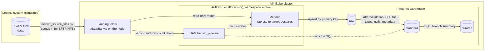

# BanVic data platform (Data Engineer certification challenge)

Proof of concept: ingest the BanVic ERP tables (7 CSV files, simulating an on-premises legacy system) into a Postgres data warehouse with `raw`, `standard` and `curated` layers. Airflow 3.2.2 orchestrates it and Meltano 4.4.1 loads the data, all on a local Minikube cluster provisioned with Terraform. No cloud account is needed.

## Architecture



Repository structure:

```
dags/        Airflow DAG and the SQL of the standard and curated layers
meltano/     Meltano project (streams, primary keys, target settings)
docker/      Dockerfile of the custom Airflow image
terraform/   Cluster resources, Airflow and the warehouse
scripts/     deliver_source_files.py (simulates the file delivery)
data/        The 7 CSV files (git-ignored)
```

## How to run

Prerequisites: Docker Desktop (running), Minikube, kubectl, Helm, Terraform and Python 3. Put the 7 BanVic CSV files in `data/` (`agencias`, `clientes`, `colaborador_agencia`, `colaboradores`, `contas`, `propostas_credito`, `transacoes`). Run the commands from the repository root.

**1. Start the cluster**

```bash
minikube start --driver=docker --cpus=4 --memory=6144 --kubernetes-version=v1.37.0
```

**2. Deliver the source files** to the cluster node (simulates the legacy export arriving):

```bash
python scripts/deliver_source_files.py
```

**3. Build the Airflow image and load it into the cluster.** The tag must match `airflow_image_tag` in `terraform/variables.tf`:

```bash
docker build -t banvic-airflow:0.2.8 -f docker/airflow.Dockerfile .
minikube image load banvic-airflow:0.2.8
```

**4. Choose the Airflow admin password.** Create `terraform/terraform.tfvars` (git-ignored, loaded automatically by Terraform):

```hcl
airflow_admin_password = "choose-a-password"
```

**5. Deploy** (first run takes a few minutes):

```bash
cd terraform
terraform init
terraform apply
cd ..
```

**6. Open Airflow.** Keep this command running and open <http://localhost:8080>, user `admin` and the password you chose in step 4:

```bash
kubectl port-forward svc/airflow-api-server 8080:8080 -n airflow
```

**7. Run the pipeline.** In the UI, unpause the DAG `banvic_pipeline` and trigger it. All 17 tasks should turn green.

**8. Check the data** in the warehouse:

```bash
kubectl exec -it warehouse-0 -n airflow -- sh -c 'psql -U $POSTGRES_USER -d $POSTGRES_DB'
```

```sql
SELECT count(*) FROM raw.transacoes;       -- 71999
SELECT * FROM standard.transacoes LIMIT 5;
SELECT * FROM curated.resumo_agencias;     -- 10 rows, one per branch
```

For a SQL client such as DBeaver, run `kubectl port-forward svc/warehouse 5433:5432 -n airflow` and connect to `localhost:5433`, database and user `banvic`. The password is generated by Terraform and stored in the `warehouse-credentials` Secret. To print it:

```bash
kubectl exec warehouse-0 -n airflow -- printenv POSTGRES_PASSWORD
```

**Cleanup:** `terraform destroy` (in `terraform/`) and then `minikube delete`. `minikube stop` only pauses the cluster and keeps everything.

## Ingestion strategy

The DAG `banvic_pipeline` runs daily and can also be triggered by hand. Only one run is active at a time, with at most two tasks at once.

```
wait_for_files > ingest_<table> (x7) > validate_counts > standardize_<table> (x7) > build_curated
```

1. **Sensor.** `wait_for_files` waits for the 7 files in the landing folder. A scheduled run also needs them to be newer than the last successful run, and is skipped if they do not arrive within 30 minutes. A manual run only needs them to exist.
2. **Extract and load (`raw`).** One task per table: `tap-csv` reads the CSV and `target-postgres` upserts it by primary key (declared in [`meltano/meltano.yml`](meltano/meltano.yml)). Everything arrives as text, plus Meltano's `_sdc_*` columns.
3. **Validation.** `validate_counts` compares the rows of each CSV with the rows of its `raw` table and fails on any difference, so bad data never reaches `standard`.
4. **Standard.** One SQL file per table in [`dags/sql/standard/`](dags/sql/standard) casts types, turns blank text into NULL, drops the `_sdc_*` columns and adds `source_extracted_at` and `processed_at`.
5. **Curated.** [`resumo_agencias.sql`](dags/sql/curated/resumo_agencias.sql) builds one row per branch (customers, accounts, balance, transactions, money in and out). It is an example; the real rules would come from the business.

**Idempotency.** Running the DAG again gives the same result: the load is an upsert, and each standard and curated table is dropped and rebuilt in one transaction.

**Known limits.** Rows deleted at the source are detected, not applied. Upsert keeps them in `raw`, so `validate_counts` fails and nothing reaches `standard`. This is deliberate: the pipeline cannot tell a real deletion from a partial export, so a person decides. Once confirmed, run `TRUNCATE raw.<table>;` and trigger the DAG again. A duplicated key in a delivery also makes the load fail.

## Monitoring and failure handling

- **Retries.** Every task retries twice, 30 seconds apart, except the row-count validation: a data problem does not fix itself.
- **Timeouts.** A task fails after 15 minutes and a run after 1 hour, instead of blocking the pipeline.
- **Failure log.** A callback on the tasks and on the DAG writes one `PIPELINE FAILURE` line (DAG, task, run, attempt, error), so even a run stopped by its timeout is reported.
- **Visibility.** The Airflow UI shows the state and the logs of each task.

## Security

No secrets are in the repository. The only value providede by the user is the Airflow admin password, in the git-ignored `terraform/terraform.tfvars`. Terraform generates the other passwords and keys and stores them as Kubernetes Secrets, which Airflow and Meltano read as environment variables, including the Airflow connection to the warehouse. Nothing is configured by hand in the UI.

## Design notes

- **Local and reproducible.** Official public images, no cloud account, no cost.
- **ELT with plain SQL.** Meltano loads the data as it arrived and the next layers are SQL files run by Airflow. For bigger data, spark could be considered.
- **Upsert instead of overwrite.** `load_method: overwrite` does not overwrite with `tap-csv` (two runs gave 20 rows), so the load is an upsert by primary key. The keys were profiled: no duplicated or empty keys.
- **Pinned plugins, DAG baked into the image.** Plugins are installed at build time with exact versions, and code and runtime ship as one versioned unit. The trade-off is a rebuild and a new tag on every DAG change.
- **Local Terraform state**, git-ignored, since it holds the generated passwords. In a team it would be a remote backend with locking.
- **CI checks, no deploy.** GitHub Actions validates every pull request; deploying would need a cluster reachable from the internet.
- **Event-driven delivery** (an Airflow asset watcher fired by a "delivery complete" marker) is the production evolution of the sensor.
