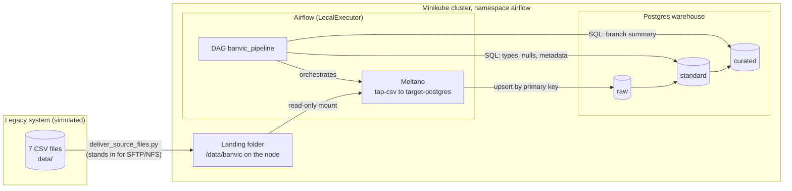

# BanVic data platform (Data Engineer certification challenge)

Proof of concept: ingest the BanVic ERP tables (7 CSV files, simulating an on-premises legacy system) into a Postgres data warehouse with `raw`, `standard` and `curated` layers, orchestrated by Airflow running on a local Kubernetes cluster. Everything runs on the local machine; no cloud account is needed.

## Architecture



| Piece | Choice |
|---|---|
| Source | Local folder with the 7 BanVic CSV files (on-premises simulation) |
| Cluster | Minikube (Docker driver) |
| Orchestration | Apache Airflow 3.2.2, official Helm chart, `LocalExecutor` |
| Ingestion | Meltano 4.4.1 (`tap-csv` → `target-postgres`), installed in the Airflow image |
| Warehouse | Postgres 17 in the cluster, schemas `raw`, `standard`, `curated` |
| Infrastructure as code | Terraform (namespace, volumes, Secrets, Postgres, Helm release) |

## Design notes

- **Local and reproducible.** Everything runs on one machine with official, public images, so anyone can reproduce it with no cloud account and no cost. Object storage was tried first (S3 on AWS, then MinIO) and dropped: S3 needs an account, and the official MinIO images are no longer publicly pullable. Postgres is one of the destinations the challenge allows. In production this would be an object-storage data lake with a managed engine; the Meltano and Airflow parts would stay the same.
- **ELT with plain SQL.** Meltano extracts and loads the data as it arrived (`raw`), and the next layers are SQL files run by Airflow. At a few MB, SQL in Postgres is the simplest tool to read, review and explain; Spark or dbt would add tooling without a gain at this scale.
- **Upsert instead of overwrite.** `load_method: overwrite` was tested and does not overwrite with `tap-csv` (two runs gave 20 rows), so the load is an upsert by primary key, which is idempotent by design. The keys were profiled beforehand: no duplicated or empty keys in any file.
- **Meltano plugins pinned.** Both plugins are pinned to the exact versions tested and installed at image build time, so a rebuild cannot pull a different plugin and tasks never download anything while running.
- **DAG baked into the image.** Code and runtime (Airflow, Meltano, DAGs) ship as one versioned unit, which is predictable. The trade-off is a rebuild and a new tag on every DAG change; `gitSync` would avoid that at the cost of depending on a GitHub branch.
- **`LocalExecutor`.** The chart default (Celery) adds workers and Redis, which is heavy for a local cluster and unnecessary here. Meltano keeps its state in a local SQLite file, so at most two tasks run at once.
- **Warehouse separate from Airflow's metadata database.** Orchestration state and business data have different lifecycles. The three schemas are created by an init script, and the empty default `public` schema is dropped.
- **One task per table** so a failure retries only that table and the UI shows each load. Each `standard` table is dropped and rebuilt in a single transaction, so re-running is safe and readers never see a half-built table.
- **Local Terraform state**, git-ignored: the simplest option for one person, and it holds the generated passwords. In a team it would be a remote backend with locking.
- **CI checks, no apply.** GitHub Actions validates the code on every pull request, but does not deploy: that would need a cluster reachable from the internet, which is out of proportion for a local Minikube.
- **Event-driven delivery** (an Airflow asset watcher fired by a "delivery complete" marker) is the production evolution of the sensor. It was not done because the landing folder is read-only and the marker would add a convention between source and pipeline for no gain at this scale.

## Repository layout

```
dags/                  Airflow DAG and the SQL of the standard and curated layers
meltano/               Meltano project (streams, primary keys, target settings)
docker/                Dockerfile of the custom Airflow image
terraform/             Cluster resources, Airflow and the warehouse
scripts/               deliver_source_files.py (simulates the file delivery)
data/                  The 7 CSV files (git-ignored, you provide them)
```

## Prerequisites

Docker Desktop (running), Minikube, kubectl, Helm, Terraform and Python 3. The 7 BanVic CSV files are not versioned: put them in `data/` (`agencias.csv`, `clientes.csv`, `colaborador_agencia.csv`, `colaboradores.csv`, `contas.csv`, `propostas_credito.csv`, `transacoes.csv`).

## How to run

Run the commands from the repository root.

**1. Start the cluster**

```bash
minikube start --driver=docker --cpus=4 --memory=6144 --kubernetes-version=v1.37.0
```

**2. Deliver the source files** to the cluster node (simulates the legacy export arriving):

```bash
python scripts/deliver_source_files.py
```

**3. Build the Airflow image and load it into the cluster.** The tag must match `airflow_image_tag` in `terraform/variables.tf`:

```bash
docker build -t banvic-airflow:0.2.8 -f docker/airflow.Dockerfile .
minikube image load banvic-airflow:0.2.8
```

**4. Choose the Airflow admin password.** Create `terraform/terraform.tfvars` (git-ignored, loaded automatically by Terraform):

```hcl
airflow_admin_password = "choose-a-password"
```

**5. Deploy** (first run takes a few minutes):

```bash
cd terraform
terraform init
terraform apply
cd ..
```

**6. Open Airflow.** Keep this command running (or send it to the background) and open <http://localhost:8080>, user `admin`:

```bash
kubectl port-forward svc/airflow-api-server 8080:8080 -n airflow
```

**7. Run the pipeline.** In the UI, unpause the DAG `banvic_pipeline` and trigger it. All 17 tasks should turn green.

**8. Check the data** in the warehouse:

```bash
kubectl exec -it warehouse-0 -n airflow -- sh -c 'psql -U $POSTGRES_USER -d $POSTGRES_DB'
```

```sql
SELECT count(*) FROM raw.transacoes;       -- 71999
SELECT * FROM standard.transacoes LIMIT 5;
SELECT * FROM curated.resumo_agencias;     -- 10 rows, one per branch
```

To browse the tables in a SQL client (e.g. DBeaver), forward the warehouse to a free local port and connect to `localhost:5433`, database and user `banvic`. The password is in the `warehouse-credentials` Secret (key `POSTGRES_PASSWORD`, base64-encoded):

```bash
kubectl port-forward svc/warehouse 5433:5432 -n airflow
```

## Ingestion strategy

The DAG `banvic_pipeline` runs daily and can also be triggered by hand. Because the source is a file delivery, a scheduled run only proceeds when the 7 files are newer than the last successful run; it waits up to 30 minutes for them and is skipped if they do not arrive. A manual run only needs the files to exist. Only one run is active at a time, with at most two tasks running at once.

```
wait_for_files > ingest_<table> (x7) > validate_counts > standardize_<table> (x7) > build_curated
```

1. **Sensor.** `wait_for_files` waits until the 7 files exist in the landing folder (and, for scheduled runs, are newer than the last successful run).
2. **Extract and load (raw).** One Meltano task per table reads the CSV with `tap-csv` and loads it with `target-postgres` into schema `raw`. Everything arrives as text, plus Meltano's `_sdc_*` columns. The primary key of each table is declared in [`meltano/meltano.yml`](meltano/meltano.yml).
3. **Validation.** `validate_counts` compares the number of rows in each CSV with the rows in the `raw` table and fails on any difference.
4. **Standard.** One SQL file per table in [`dags/sql/standard/`](dags/sql/standard) casts the types (integers, numerics, dates, timestamps), turns blank text into NULL, drops the `_sdc_*` columns and adds `source_extracted_at` and `processed_at`.
5. **Curated.** [`dags/sql/curated/resumo_agencias.sql`](dags/sql/curated/resumo_agencias.sql) builds `curated.resumo_agencias`: one row per branch with its customers, accounts, total balance, number of transactions, and money in and out. It is an example analyst-ready table; the real curated rules would come from the business.

**Idempotency.** Running the DAG again gives the same result. The load is an upsert by primary key (no duplicated rows), and each standard and curated table is dropped and rebuilt in a single transaction.

**Known limits:** rows deleted at the source are detected, not applied. Upsert keeps them in `raw`, so `validate_counts` fails and nothing reaches `standard`. This is deliberate: the pipeline cannot tell a real deletion from a partial export, so a person decides. Once the deletion is confirmed, empty the affected table (`TRUNCATE raw.<table>;`) and trigger the DAG again. A duplicated key in a future delivery also makes the load fail.

## Monitoring and failure handling

- **Retries.** Every task retries twice, waiting 30 seconds between attempts, so transient failures can clear. The row-count validation does not retry: a data problem does not fix itself.
- **Timeouts.** A task that hangs fails after 15 minutes, and a run after 1 hour, instead of blocking the pipeline.
- **Failure log.** A failure callback writes one `PIPELINE FAILURE` line with DAG, task, run, attempt and error, easy to find in the task log. The same callback is set on the DAG, so a run stopped by its timeout is reported too.
- **Data validation.** The row-count check stops the pipeline before bad data reaches `standard`.
- **Sensor timeout.** If no new delivery arrives, the sensor stops after 30 minutes and the run is skipped instead of waiting forever.
- **Visibility.** The Airflow UI shows the state and the logs of each task.

## Security

No secrets are stored in the repository. The only value you provide is the Airflow admin password, in `terraform/terraform.tfvars`, which is git-ignored (see "How to run"). The other passwords and keys (warehouse, Airflow keys) are generated by Terraform and stored as Kubernetes Secrets, which Airflow and Meltano read as environment variables. The Airflow connection to the warehouse is built from a Secret as well, so nothing is configured by hand in the UI.

## Cleanup

```bash
cd terraform
terraform destroy
cd ..
minikube delete
```

`minikube stop` only pauses the cluster and keeps the image, the files and the data; `minikube delete` removes everything.
